<div align="center">

# Gen4Understand

**Generation-for-Understanding with Structured Action Scripts for Embodied Multimodal Learning**

**Accepted at NeurIPS 2026**

Structured processes · Grounded synthesis · Calibrated supervision

</div>

Gen4Understand specifies an embodied interaction **before** generating its video. Atomic action scripts describe the actor, action, object, initial state, motion, resulting state, and temporal relation. Real start/end frames constrain synthesis; a five-component verifier selects reliable clips; hierarchical captioning and QA transfer the resulting supervision to a vision-language model.

This repository is a paper-guided implementation of the data engine, verifier mathematics, hierarchy construction, adaptation interface, and evaluation protocol. It includes an executable CPU fixture and regression tests. Original training videos, proprietary generation services, model checkpoints, and robot hardware are not distributed. Full-scale paper results have **not** been reproduced by this release. Acceptance status is supplied by the project owner.

## Pipeline

```mermaid
flowchart LR
    A[Real recordings] --> B[Partition by source / scene / object]
    B --> C[Atomic event scripts]
    C --> D[Real start + end frames]
    D --> E[4 generated candidates per event]
    C --> E
    E --> F[Semantic / anchor / physical / temporal / quality]
    F --> G[Calibrated top-1 selection]
    G --> H[Atom / action / subtask / task]
    H --> I[Caption + QA supervision]
    I --> J[Frozen vision encoder + LLM LoRA + projector]
```



## Quick start

Python 3.10 or newer. The data pipeline runs on CPU; full VLM adaptation requires a suitable CUDA GPU and separately obtained data/model access.

```bash
python -m venv .venv
# Linux/macOS: source .venv/bin/activate
# Windows PowerShell: .venv\Scripts\Activate.ps1
python -m pip install -e ".[dev]"

g4u demo --output runs/demo
g4u validate runs/demo/events.jsonl
pytest -q
```

The demo creates two explicitly labeled synthetic fixture videos, eight candidate records, two accepted events, three hierarchy levels, and a QA manifest. Its scores are deterministic fixtures, not neural verifier outputs. No API key or remote model is used.

## What is implemented

| Component | Implementation |
|---|---|
| Structured events | Validated seven-slot event schema, deterministic captions, context-aware hard negatives |
| Source isolation | Recording/scene/object-instance partition checks, event-tuple deduplication, endpoint feature screening helper |
| Grounded generation | Real anchor extraction; independent requests for two Wan2.7 and two Seedance 2.0 candidates; local adapter protocol |
| Verification | Semantic Slot-F1, endpoint feature/IoU matching, geometric relation checks, flow-error/trajectory formula, external DOVER score |
| Calibration | Training-only min–max fitting, frozen/clipped normalization, audited weight/threshold search, minimum coverage |
| Selection | Track-presence gate before ranking; at most one accepted video per event |
| Hierarchy | All-child acceptance, temporal ordering, duplicate-boundary removal, synchronized script supervision |
| Transfer | Caption/action/state/order/negative QA; optional approximate paper-instance-budget mode |
| Adaptation | Qwen-family loader, frozen visual encoder, rank-64/alpha-128 LLM LoRA, trainable projector, response-only weighted loss |
| Evaluation | FG components, exact match, FAR/FIR/DR, control metrics, Wilson intervals, paired stratified bootstrap, visual interventions |

The generator and frozen verifier models are **external dependencies**. The repository does not substitute a small network or image interpolation for the paper's generators. See [adapters](docs/adapters.md) for the concrete handoff contracts and [paper alignment](docs/paper-alignment.md) for implementation choices and unavailable artifacts.

## Build a dataset

Prepare JSONL events using [the example](examples/event.json) and [data contracts](docs/data-format.md). Paths should be absolute or relative to the current working directory. Validate the complete partitioned event list before exporting a training-only subset.

```bash
g4u validate data/all-events.jsonl
g4u plan data/train-events.jsonl --output runs/generation --seed 42

# Your local adapter handles authorized provider access and writes response.json.
g4u generate runs/generation/requests.jsonl --output runs/candidates --adapter python adapters/provider.py

# Export frozen verifier measurements using docs/adapters.md, then score them.
g4u score data/calibration-observations.jsonl data/train-events.jsonl --output runs/calibration-scores.jsonl
g4u calibrate runs/calibration-scores.jsonl --strict-paper-size --output runs/calibrator.json
g4u score data/production-observations.jsonl data/train-events.jsonl --output runs/production-scores.jsonl
g4u select runs/production-scores.jsonl runs/calibrator.json --output runs/accepted.jsonl
g4u build data/train-events.jsonl data/units.jsonl runs/accepted.jsonl --output runs/dataset --qa-mode paper-budget
```

`adapters/provider.py` is an integration path you supply, not a bundled vendor client. Generator requests specify five seconds, 720p, both anchors, and the seed. Generation is explicit and may incur provider charges. The `generate` command never runs as part of the demo or tests.

Calibration and production events must be disjoint. Use `--paper-weights` to retain the published weights and threshold while fitting extrema on your own calibration data; omit it to search the audited calibration grid. A calibration file with constant components is rejected rather than silently assigning arbitrary scores.

## Adapt and infer

```bash
python -m pip install -e ".[train]"
g4u train --config configs/train_qwen25_7b.yaml --data runs/dataset/train.jsonl --output checkpoints/g4u-qwen25-7b
g4u predict --model Qwen/Qwen2.5-VL-7B-Instruct --adapter checkpoints/g4u-qwen25-7b --data data/inference.jsonl --output runs/predictions.jsonl
```

The supplied configuration uses three epochs, AdamW at `1e-4`, cosine decay with `0.03` warmup, batch size 4, accumulation 4, BF16, 16 uniformly sampled frames, and 4096 tokens. Level weights are `atom=1.0`, `act=0.5`, `sub=0.3`, `task=0.2`; this release applies them once to response-token loss. The visual backbone stays frozen while the projector is saved with the adapter. Training rejects examples that exceed the token budget instead of truncating visual tokens or answers.

Qwen2.5-VL is the primary integration target. Other Qwen-derived backbones must pass explicit module-layout validation. RoboBrain-specific loading and native robot/benchmark runners are not bundled. Full pretrained-model training/inference requires integration validation on the target GPU environment; local verification does not claim that run.

## Evaluate

```bash
g4u evaluate structural data/structural-predictions.jsonl --output runs/fg.json
g4u evaluate hallucination data/distractor-predictions.jsonl --output runs/distractor.json
g4u evaluate control data/robot-trials.jsonl --output runs/control.json
```

Metrics are returned as fractions, not percentages. Structural evaluation requires real annotations for all four FG components; missing predictions count as incorrect. FAR and FIR count clips containing any unsupported action/intent, not the number of unsupported words. Evaluation records and source-stratified paired bootstrap usage are documented in [evaluation](docs/evaluation.md).

## Paper results for context

The following values are transcribed from the manuscript, **not measured from this repository**. FG is averaged over the three public-source diagnostic splits.

| Backbone | Base FG | Real post-hoc FG | Gen4Understand FG |
|---|---:|---:|---:|
| Qwen2.5-VL-3B | 45.5 | 49.1 | 53.2 |
| Qwen2.5-VL-7B | 51.0 | 53.6 | 59.9 |
| Qwen3-VL-4B | 51.6 | 54.8 | 58.7 |
| RoboBrain2.5-4B | 54.5 | 57.3 | 61.1 |

The paper reports 20K retained atomic clips, 8K hierarchical clips, and approximately 56K instruction instances. It also reports residual errors among accepted clips; verifier scores are visual/relational proxies and do not certify physical correctness.

## Repository guide

```text
src/gen4understand/
  schema.py, scripts.py, splits.py   # Event semantics and provenance
  generation.py, video.py            # Anchors, adapter execution, video merging
  scoring.py, verifier.py            # Measurements, calibration, selection
  pipeline.py                       # Multi-granularity dataset construction
  training.py, inference.py          # Optional VLM adaptation and inference
  metrics.py                        # Structural, distractor, control evaluation
  cli.py, demo.py                    # Commands and CPU fixture
configs/                            # Published settings and runnable SFT config
docs/                               # Contracts, method mapping, evaluation
tests/                              # Numerical and pipeline regressions
```

## Development

```bash
ruff check .
ruff format --check .
pytest -q
python -m build
```

CI runs the CPU pipeline and loss-gradient test on Python 3.10 and 3.12. Tests cover calibration leakage, track rejection, threshold boundaries, hierarchy completeness, mask matching, physical windows, missing predictions, uncertainty estimates, and prompt masking.

## License

Original code in this repository is MIT-licensed. External model weights, source datasets, generated media, and provider services retain their own terms. No paper PDF, author list, affiliation, contact details, private dataset, or credentials are included.
